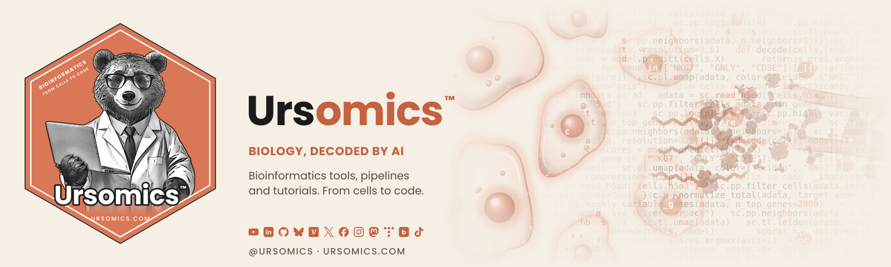
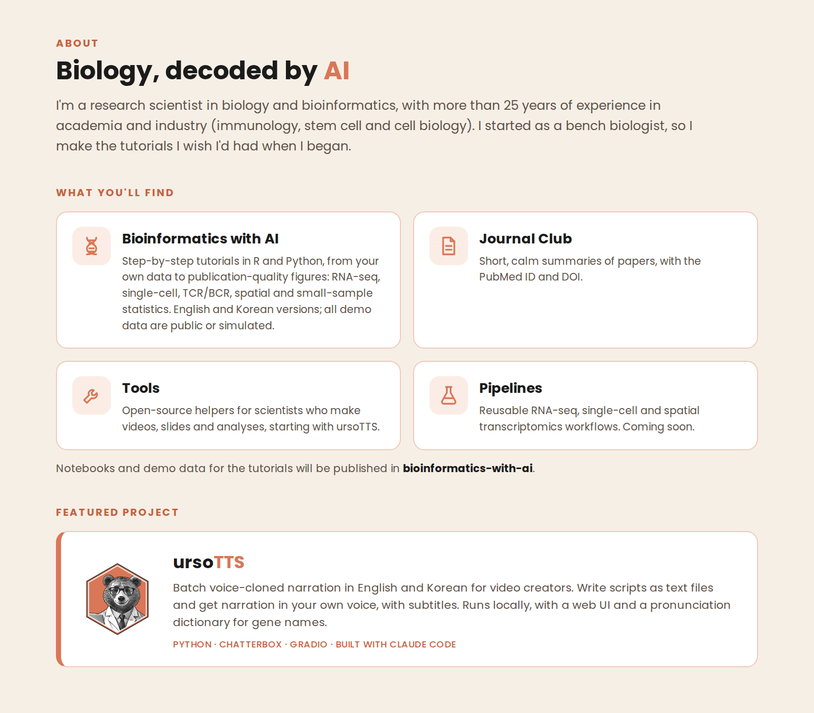

  <picture>
    <source media="(prefers-color-scheme: dark)" srcset="images/org_readme_banner_dark_1600x480.png">
    
  </picture>

  
  
  

  <picture>
    <source media="(prefers-color-scheme: dark)" srcset="images/ursomics_profile_body_dark.png">
    
  </picture>

